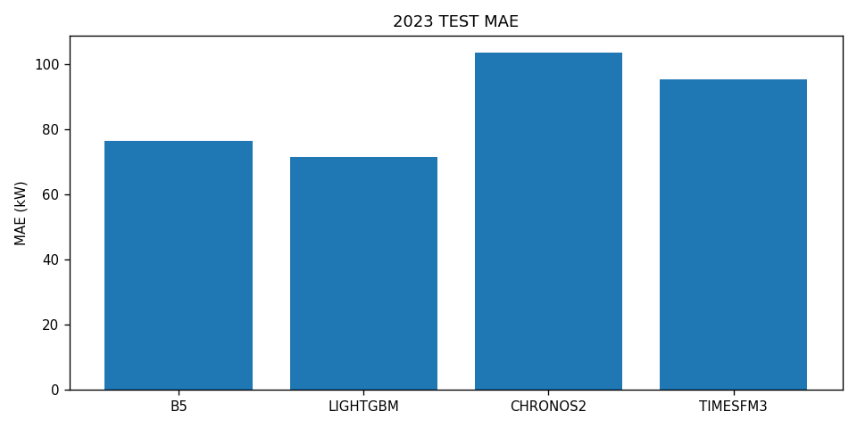
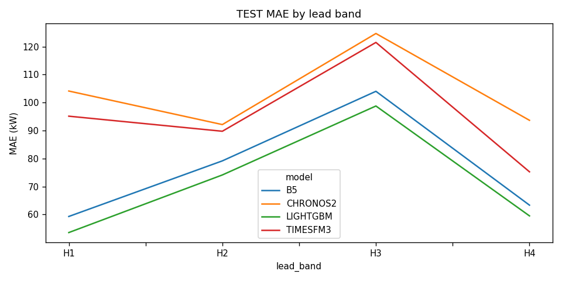

# Leakage-safe day-ahead forecasting of industrial signed grid exchange

> A provenance-aware, operationally realistic benchmark for 15-minute day-ahead forecasting at the Honda R&D Europe smart-building site—covering data forensics, observation-level quality masks, a frozen evaluation protocol, transparent baselines, site-specific LightGBM, and zero-shot time-series foundation models.

[](https://www.python.org/)
[](tests/honda)
[](config/honda_forecasting_protocol_frozen.json)
[](https://doi.org/10.5061/dryad.73n5tb363)

## Why this repository exists

Industrial-energy forecasting studies often begin after the most consequential scientific decisions have already been made: what a timestamp means, whether a value was measured or filled, when a measurement becomes operationally available, and which periods may be used for model selection. This repository makes those decisions explicit and testable before comparing models.

The forecasting target is **signed net exchange with the public grid**, not gross industrial electricity consumption:

- positive values are grid import;
- negative values are grid export;
- negative targets and predictions are preserved;
- observed-original targets are kept separate from corrected, filled, unknown, and unresolved values.

That distinction matters because behind-the-meter PV, CHP, thermal systems, and operational changes can alter grid exchange without implying the same change in gross site demand.

## Research contributions

The current project state (H1–H6) provides:

1. **Forensic source audit.** Timestamp semantics, units, aggregation behaviour, structural gaps, corrections, and reconstruction risks are documented from the released Honda data and supporting sources.
2. **Observation-level provenance.** A SILVER layer and provenance masks distinguish `OBSERVED_ORIGINAL`, `CORRECTED_NONIMPUTED`, `IMPUTED_OR_FILLED`, `UNKNOWN_PROVENANCE`, and `MISSING_UNRESOLVED` intervals.
3. **Frozen operational protocol.** Forecasts are issued at 13:00 Europe/Berlin on D-1 for every physical 15-minute interval of local day D, including 92/96/100-interval DST days.
4. **Strict leakage controls.** Historical measurements are available only when `interval_end_utc <= forecast_issue_time_utc`. Future realised weather, PV, CHP, and thermal variables are forbidden.
5. **Transparent baseline benchmark.** Six auditable methods (B0–B5) quantify persistence, daily/weekly recurrence, robust analogues, calendar climatology, and a simple ensemble.
6. **Site-specific deterministic ML benchmark.** LightGBM M0/M1 models test the incremental value of leakage-safe grid history and historical energy context.
7. **Zero-shot foundation-model benchmark.** Amazon Chronos-2 and Google TimesFM 3.0 are evaluated without fine-tuning under the same target set, issuance time, DST handling, and metrics.
8. **Reproducible evidence.** Frozen configurations, prediction tables, manifests, bootstrap comparisons, leakage audits, figures, and 94 automated tests are committed.

## Frozen forecasting task

| Element | Frozen definition |
|---|---|
| Target | `grid_exchange_kw_signed` |
| Meaning | Physical net electrical exchange with the public grid |
| Unit and sign | kW; import positive, export negative |
| Resolution | 15 minutes |
| Issuance | 13:00 Europe/Berlin on D-1 |
| Target day | Every physical interval of local calendar day D |
| Historical cutoff | `interval_end_utc <= forecast_issue_time_utc` |
| Primary target quality | `OBSERVED_ORIGINAL` only |
| Sensitivity quality | `OBSERVED_ORIGINAL + CORRECTED_NONIMPUTED` |
| Development folds | 2020→2021 and 2020–2021→2022 |
| Final refit period | 2020–2022 |
| Untouched test | 2023 |
| Primary metric | MAE with full coverage reporting |
| Bootstrap unit | Whole local calendar day; 2,000 resamples; seed 20261029 |

The physical lead range is 11–34.75 hours on ordinary days, 11–33.75 hours on the spring DST day, and 11–35.75 hours on the autumn DST day. The complete frozen specification is in [`config/honda_forecasting_protocol_frozen.json`](config/honda_forecasting_protocol_frozen.json).

## Headline results

All headline TEST results use the same 34,161 observed-original 2023 targets and 100% prediction coverage unless noted otherwise.

| Method | Adaptation | MAE (kW) | RMSE (kW) | Bias (kW) | NMAE | Export recall |
|---|---:|---:|---:|---:|---:|---:|
| B5 transparent ensemble | Development-selected rules | 76.480 | 101.338 | +6.649 | 0.542 | 30.81% |
| LightGBM M1-CHP | Site-specific training | **71.513** | **96.974** | +9.408 | **0.507** | 29.75% |
| TimesFM 3.0 C1 | Zero-shot | 95.431 | 129.221 | −0.040 | 0.676 | 11.22% |
| Chronos-2 C1 | Zero-shot | 103.672 | 139.959 | −6.184 | 0.734 | 11.54% |



### Main scientific findings

- LightGBM improves MAE by **4.967 kW (6.49%)** over the strong frozen B5 ensemble while retaining complete coverage.
- The zero-shot foundation models achieve complete operational coverage but do not match the transparent baseline or site-specific ML model.
- Whole-day bootstrap intervals show robust degradation for both foundation models relative to B5 and LightGBM, rather than an inconclusive tie.
- Export-state recognition remains an open problem: LightGBM improves aggregate error but does not improve export recall, while both foundation models reduce it substantially.
- The 23–29 hour H3 band is the hardest horizon for all evaluated methods.
- The 2020 operating regime is retained in the primary protocol for structural diversity, while a separate post-2020 sensitivity protocol prevents that research choice from being hidden.
- Raw kW errors should not be compared directly with SPARK results: SPARK is consumption-like site demand, whereas Honda is signed net grid exchange.



## Study stages

| Stage | Purpose | Main artifact |
|---|---|---|
| H1 | Source and semantic audit | [`reports/honda_reduced_dataset_audit.md`](reports/honda_reduced_dataset_audit.md) |
| H2 | Provenance-aware SILVER and target eligibility | [`reports/honda_provenance_and_silver.md`](reports/honda_provenance_and_silver.md) |
| H3A | Forecasting feasibility and availability evidence | [`reports/honda_forecasting_protocol_h3a.md`](reports/honda_forecasting_protocol_h3a.md) |
| H3B | Frozen forecasting protocol | [`reports/honda_forecasting_protocol.md`](reports/honda_forecasting_protocol.md) |
| H4 | Leakage-safe B0–B5 baseline benchmark | [`reports/honda_baseline_benchmark.md`](reports/honda_baseline_benchmark.md) |
| H5 | Deterministic LightGBM M0/M1 benchmark | [`reports/honda_deterministic_ml_benchmark.md`](reports/honda_deterministic_ml_benchmark.md) |
| H6 | Chronos-2 and TimesFM 3.0 zero-shot benchmark | [`reports/honda_foundation_model_benchmark.md`](reports/honda_foundation_model_benchmark.md) |

Each stage was committed only after its tests, deterministic generation, leakage checks, and protected-artifact verification passed. Later stages consume frozen earlier artifacts rather than silently revising them after seeing TEST performance.

## Methods at a glance

### Baselines B0–B5

- **B0:** most recent provenance-safe observation at issuance, held constant;
- **B1:** most recent safe matching local quarter-hour from an earlier calendar day;
- **B2:** exact matching quarter-hour seven local calendar days earlier;
- **B3:** robust median across selected prior weekly analogues;
- **B4:** training-only calendar climatology with frozen fallback hierarchy;
- **B5:** development-selected fixed ensemble of transparent components.

All analogue matching uses local-calendar semantics and a UTC physical key, avoiding fixed `t−96` assumptions across DST transitions.

### LightGBM

- **M0:** future-known calendar information plus issuance-safe grid-history analogues, recent state, volatility, and export-history summaries;
- **M1:** M0 plus allowed pre-issuance historical energy context;
- selected model: **M1 with historical CHP context**;
- target objective: L1/MAE-oriented regression;
- missing historical values remain NaN rather than being replaced with author-filled measurements.

### Foundation models

- **Chronos-2:** official `amazon/chronos-2` checkpoint, 14-day selected context, C1 calendar + historical CHP mode;
- **TimesFM 3.0:** official `google/timesfm-3.0-pytorch` checkpoint, 28-day selected context, C1 mode;
- no gradients, adapters, LoRA, prompt tuning, or Honda-specific weight updates;
- deterministic medians used for the H6 point-forecast comparison;
- locally isolated environments prevent foundation-model dependencies from changing the H1–H5 environment.

## Data provenance and availability

The source dataset is the Honda R&D Europe smart-building release on Dryad:

> Honda Research Institute Europe GmbH. Dataset DOI: [10.5061/dryad.73n5tb363](https://doi.org/10.5061/dryad.73n5tb363).

Downloaded source archives, extracted source data, generated SILVER parquet files, and model weights are intentionally excluded from Git. This repository contains code, frozen configurations, reports, manifests, compact predictions, summary tables, and figures needed to inspect the scientific workflow.

Important provenance findings include:

- 2018–2019 do not supply primary observed-original grid targets under the adopted policy;
- 2020–2023 contain 24,145 / 34,281 / 34,624 / 34,161 eligible primary intervals;
- complete primary days number 187 / 342 / 356 / 347 by year;
- gross reconstructed load is not approved as a forecasting target;
- corrected and filled values are never silently treated as original observations.

## Repository structure

```text
config/                  Frozen protocol and selected-model configurations
data/                    Raw/staging placeholders; large data products are ignored
docs/                    Source and schema documentation
reports/                 Research reports for H1–H6
results/
  audit/                 Source-audit evidence
  provenance/            H2 provenance evidence
  protocol_h3a/          Feasibility analysis
  protocol/              Frozen-protocol summaries
  baselines/             H4 predictions, diagnostics, figures, manifest
  ml/                    H5 predictions, ablations, diagnostics, figures, manifest
  foundation/            H6 predictions, diagnostics, figures, manifest
src/honda/               Deterministic implementation
tests/honda/             Audit, leakage, chronology, DST, and reproducibility tests
```

## Reproduction

### Core environment

```powershell
python -m venv .venv
.\.venv\Scripts\Activate.ps1
python -m pip install --upgrade pip
python -m pip install -e .
python -m pytest -q
```

The committed suite currently contains **94 tests**. Tests cover provenance rules, signed-target preservation, issuance cutoffs, 92/96/100-interval DST days, chronological folds, 2023 access guards, baseline lineage, feature leakage, common-target comparison, whole-day bootstrap determinism, frozen configurations, and the absence of prohibited training or optimization artifacts.

### Stage-specific execution

The main generation modules are:

```powershell
python -m src.honda.audit
python -m src.honda.h2_provenance
python -m src.honda.h3a_protocol_analysis
python -m src.honda.h3b_freeze_protocol
python -m src.honda.h4_baseline_benchmark
python -m src.honda.h5_deterministic_ml
```

H6 uses isolated Chronos and TimesFM environments because their neural dependencies differ from the core project. Exact package states, checkpoint revisions, checkpoint hashes, devices, precision, runtime, and memory measurements are recorded under [`results/foundation/`](results/foundation/).

Reproduction from raw data requires obtaining the Dryad release and following the acquisition/provenance notes. The generators deliberately fail when protected source or frozen-artifact hashes do not match expectations.

## Reproducibility safeguards

- UTC is the unique physical key; Europe/Berlin defines operational calendar semantics.
- Frozen configuration files are written before TEST inference.
- Model selection uses concatenated 2021 and 2022 validation targets with equal target weighting.
- 2023 labels are unavailable to context, feature, hyperparameter, or model selection.
- Pairwise claims use common predicted targets and whole complete days.
- Bootstrap comparisons use 2,000 whole-day resamples with fixed seed `20261029`.
- Manifests record protected commits, configuration hashes, source hashes, prediction hashes, packages, seeds, and deterministic artifacts.
- H6 CUDA inference reproduced byte-identically on the recorded hardware/software stack.

## Limitations

- This is a single-site industrial case study; transfer to other facilities is an empirical question.
- The target is net grid exchange, not gross demand, so behind-the-meter generation and controls are inseparable from the operational target by design.
- The released observations contain corrections, fills, and incomplete periods; strict provenance rules reduce usable sample size.
- Weather forecasts are not part of the primary benchmark. Future realised weather is forbidden.
- The 2023 modernization boundary is available only at month precision and is used for diagnostics, not causal claims or tuning.
- Foundation-model results apply to the frozen checkpoints and inference modes recorded in H6; they are not a universal ranking of model families.
- No repository software license has yet been declared. Dataset use remains governed by the source dataset's terms.

## Research roadmap

The recommended next stage is **probabilistic forecasting and temporally coherent daily scenario generation**. It should compare deterministic residual trajectories, probabilistic LightGBM, and scientifically usable foundation-model uncertainty outputs. The primary stochastic object should be a coherent daily trajectory rather than independent marginal quantiles, enabling later flexibility and market-decision studies without breaking temporal dependence.

## Citation

If you use this workflow, please cite the original Dryad dataset and this repository. A formal archived software DOI has not yet been assigned; until then, cite the repository URL and the exact Git commit used.

```text
MhdAsker. Leakage-safe day-ahead forecasting of industrial signed grid exchange:
provenance, baselines, LightGBM, and zero-shot foundation models.
GitHub repository, https://github.com/MhdAsker/Industrial_flexibilty_regime_aware_forecasting
```

## Contact and responsible use

Questions, reproducibility reports, and scientifically motivated extensions are welcome through GitHub issues. Please distinguish signed grid exchange from gross industrial load when discussing results, and do not report performance without its target-quality and prediction-coverage context.
